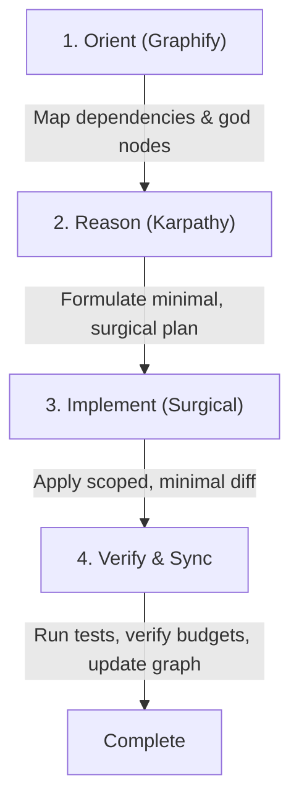

# AGENTS.md — Agent Operating System & Engineering Protocol

> This document defines the operational directives, architectural reasoning rules, and execution standards for any AI agent working within this repository.
> All agent turns must strictly comply with **The Karpathy Engineering Principles** and utilize the **Graphify Knowledge Graph** framework for codebase discovery and impact analysis.

---

## 1. Core Philosophy: The Karpathy Principles

Agents operate under Andrej Karpathy's four pillars of disciplined software craftsmanship. These are hard constraints, not loose guidelines.

### I. Think Before Coding
* **Zero silent assumptions:** Never guess user intent, implicit contracts, or underlying causes. If an instruction is ambiguous, explicitly state interpretations or ask for clarification before proceeding.
* **Surface architectural trade-offs:** Before writing code, state the approach, risks, and alternatives.
* **Inspect before touching:** Always inspect existing patterns and call graphs using Graphify before modifying files.

### II. Simplicity First (Radical Parsimony)
* **Minimum code that solves the problem:** Zero speculative features, zero future-proofing, zero unnecessary helper utilities.
* **No premature abstractions:** Code should remain concrete until duplication is proven painful. Three concrete implementations are better than one premature abstraction.
* **Concise and idiomatic:** Prefer 30 clear, readable lines over 150 lines of complex indirection.

### III. Surgical Changes & Blast Radius Control
* **Touch only what you must:** Modify only the exact lines and functions required to solve the task.
* **Preserve surrounding integrity:** Do not refactor adjacent functions, reformat unchanged code, or alter unaffected comments/whitespace.
* **Zero collateral diffs:** Keep git diffs minimal, focused, and immediately reviewable.
* **Artifact cleanup:** Clean up all intermediate scratch files, test logs, or temporary outputs before completion.

### IV. Goal-Driven & Verified Execution
* **Falsifiable criteria:** Define measurable success criteria before writing code (e.g., passing tests, matching bundle size budgets, zero type errors).
* **Verify in a loop:** Never conclude a task without executing verification commands (builds, tests, linters).
* **Inspect errors deeply:** If a test or build fails, read the full stack trace and diagnose the root cause rather than applying haphazard trial-and-error patches.

---

## 2. Codebase Intelligence: Graphify Protocol

This repository leverages **Graphify** to construct and maintain a queryable knowledge graph of code dependencies, god nodes, and community structures.

### Fast-Path Check
Before executing text searches or broad directory traversals, verify whether the knowledge graph exists:
* Check for `graphify-out/graph.json` or `graphify-out/GRAPH_REPORT.md`.
* If it exists, **always query the graph first** to navigate architecture and trace dependencies.

### Graphify Query Commands
| Need | Command | Purpose |
| :--- | :--- | :--- |
| **Broad Context** | `graphify query "<question>"` | BFS traversal through community clusters and central nodes. |
| **Execution Flow** | `graphify query "<question>" --dfs` | Traces deep call graphs, data pipelines, and function call chains. |
| **Impact Analysis** | `graphify path "<SourceNode>" "<TargetNode>"` | Discovers shortest dependency paths and bridging nodes between modules. |
| **Node Inspection** | `graphify explain "<NodeName>"` | Provides structured, plain-language breakdown of a component or module. |
| **Incremental Sync**| `graphify <path> --update` | Re-extracts only new or modified files after non-trivial changes. |

### Graph Integrity & Edge Fidelity
* **EXTRACTED edges:** Deterministic AST imports, exports, and call references. Treat as ground truth.
* **INFERRED edges:** Semantic or co-occurrence relationships detected across modules. Treat as structural hypotheses requiring source verification.
* **AMBIGUOUS edges:** Unresolved dynamic bindings. Must be manually validated in source code.

---

## 3. Unified Agent Execution Flywheel

When given a development, refactoring, or bug-fix task, follow this 4-phase lifecycle:

### Phase 1: Orient (Graphify)
1. Locate relevant entry points, components, and hooks.
2. Query the graph (`graphify query` / `graphify path`) to discover downstream dependents and prevent breaking contract boundaries.
3. Review community boundaries (e.g., core engine vs. effects vs. application consumers).

### Phase 2: Reason (Karpathy Pre-flight)
1. Write down:
   - What is the exact problem?
   - What are the explicit assumptions?
   - What is the minimal change needed?
   - What are the potential failure modes?
2. If ambiguities exist, halt and clarify with the user.

### Phase 3: Implement (Surgical Execution)
1. Open the target file(s) and apply minimal, precise edits.
2. Adhere strictly to existing coding styles, TypeScript configurations, and naming conventions.
3. Avoid modifying adjacent code or introducing unrelated cleanups.

### Phase 4: Verify & Sync
1. Run local test and typecheck suites (e.g., `pnpm test`, `pnpm build`).
2. Verify constraints (e.g., package size limits, SSR safety, zero circular imports).
3. If new files, components, or major exports were created, run `graphify . --update` to refresh the project graph.

---

## 4. Repository Context & Architectural Constraints

* **Project:** `react-weather-overlays` (monorepo managed with `pnpm`).
* **Architecture Guide:** Refer to [ARCHITECTURE.md](file:///c:/Users/santo/Documents/weather-package/ARCHITECTURE.md) for full contracts.
* **Core Rule:** Single 2D `<canvas>` element owned exclusively by `<WeatherCanvas>`. Never attach WebGL or transfer to workers on the main canvas.
* **Package Boundaries:**
  - `packages/core`: Internal engine (Ticker, Canvas, Pool, Hooks).
  - `packages/effects`: Internal effect modules (`Rain`, `Snow`, `Fog`, `Lightning`, etc.).
  - `packages/react-weather-overlays`: Public facing bundle aggregating core + effects.
* **Bundle Constraint:** Core engine target is **< 5kB gzipped**. Guard against large external dependencies.
