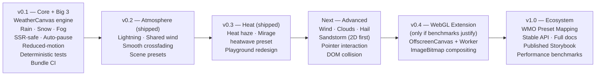

# `react-weather-effects` — Architecture & Build Plan (v4 — Implementation Contracts)

> A unified, zero-config-by-default React library for composable weather effects.
> Target: **< 5kB gzipped core**, tree-shakeable, SSR-safe, accessible.

---

## 📦 Package Structure

```
react-weather-effects/            ← monorepo root (pnpm workspaces)
├── packages/
│   ├── core/                     ← INTERNAL: WeatherCanvas engine, ticker, pool, hooks
│   ├── effects/                  ← INTERNAL: Rain, Snow, Fog, Lightning, Heat + scene presets
│   └── react-weather-effects/    ← PUBLISHED: thin entry — re-exports core + effects
├── apps/
│   └── demo/                     ← Vite playground (deployed live demo)
├── test/                         ← Vitest suite (jsdom + vitest-canvas-mock)
├── pnpm-workspace.yaml
├── tsup.config.base.ts           ← shared build settings; public package bundles internal workspaces
└── tsconfig.base.json
```

Planned, not yet in the repository: `packages/wmo/` (`fromWMOCode()` preset mapper, published separately) and `apps/storybook/` (visual QA, deterministic scenes, Chromatic CI). Wind, Clouds, Hail, and Sandstorm effects are roadmap items.

> [!IMPORTANT]
> **Publishing strategy for v0.1:** Only `react-weather-effects` is published to npm. `core` and `effects` are internal workspace packages — not independently versioned or published. This eliminates cross-package version synchronization complexity. The WMO mapper ships separately as `@react-weather-effects/wmo` when ready (post-v0.1).

Name the internal packages `@react-weather-effects/core` and `@react-weather-effects/effects`, with `"private": true`. Their runtime code and public-facing declarations must be bundled into the published package; an installed consumer must never need to resolve either private package. Internal effects retain an external dependency on core during their own build; the public package bundles both together so every effect uses the same `TickerCtx` instance.

---

## 🏗️ Core Architecture

### Canvas Ownership

**One canvas element. One 2D context. Owned entirely by `<WeatherCanvas>`.**

```
<WeatherCanvas>
  ├── Creates and owns the <canvas> element
  ├── Acquires a single CanvasRenderingContext2D (with null check)
  ├── Applies DPR scaling centrally — effects draw in CSS pixels
  ├── Owns canvas clearing between frames
  ├── Isolates effect drawing state with save/restore, catch/finally, and beginPath
  ├── Runs one requestAnimationFrame ticker (cancelled when inactive)
  ├── Distributes FrameState to registered effects each tick
  ├── Sets aria-hidden="true" on the canvas (decorative element)
  └── Provides z-index prop for fullscreen stacking control

  <Rain />       ← registers a draw function, receives FrameState
  <Snow />       ← registers a draw function, receives FrameState
  <Fog />        ← registers a draw function, receives FrameState
```

> [!IMPORTANT]
> **Canvas context exclusivity.** Once `WeatherCanvas` calls `canvas.getContext('2d')`, that canvas cannot also hold a WebGL context or be transferred to a worker via `transferControlToOffscreen`. These are mutually exclusive. The WebGL/Worker path for effects like Sandstorm requires a **separately designed extension** — a hidden secondary canvas whose frames are composited as `ImageBitmap` onto the main canvas. This is a post-v0.1 design problem.

> [!WARNING]
> **`getContext('2d')` can return `null`** — when the canvas is already bound to another context type, or the browser cannot allocate the backing store. Keep the provider mounted so child registration remains valid, skip drawing and scheduling, log a development warning, and invoke `onContextLost` once for the unavailable state. Handle a later context-loss event with the same transition. On restoration, reapply backing dimensions and drawing state, invalidate, and resume only if the other eligibility conditions allow it.

---

### TickerContext — Registration Contract

Children **never** own their own `requestAnimationFrame`. Each effect registers a draw function and receives its cleanup:

```ts
// packages/core/src/TickerContext.ts

export interface FrameState {
  ctx:       CanvasRenderingContext2D;
  dt:        number;          // seconds; capped at 0.1s; 0 on first frame after pause
  isAnimating: boolean;       // false for static/paused rendering; dt=0 may still be animated
  width:     number;          // CSS pixels
  height:    number;          // CSS pixels
  dpr:       number;          // clamped DPR applied by engine
  budget:    Readonly<RenderBudget>; // current per-canvas quality settings
  wind:      Readonly<{ x: number; y: number }>;
  pointer:   Readonly<{ x: number; y: number }> | null; // null in v0.1; ref-backed in v0.3
  timestamp: number;          // simulation ms since scene start; excludes paused time
  random:    () => number;    // seeded PRNG — never use Math.random() in effects
}

export type DrawFn = (state: Readonly<FrameState>) => void;

export interface TickerContext {
  /**
   * Register a draw function at a given layer priority.
   * Returns a cleanup function that unregisters it.
   * Auto-generates an opaque identity — multiple instances of the same
   * effect type coexist safely.
    */
  register: (layer: number, fn: DrawFn) => () => void;

  /** Mark the scene dirty; coalesce render-only updates without stepping simulation. */
  invalidate: () => void;

  /** Read this canvas's latest budget during effect setup; stable getter identity. */
  getBudget: () => Readonly<RenderBudget>;

  /** Track async texture initialization for the internal capture-readiness barrier. */
  trackAsset: (task: Promise<void>) => () => void;
}

export const TickerCtx = React.createContext<TickerContext | null>(null);
```

The context object and all its methods have stable identities for a mounted canvas. Mutable settings live in engine refs; effects read the current budget from `FrameState.budget` on every draw. Each canvas owns its registry, budget, clock, PRNG, and pending asset tasks. The engine may reuse its frame object: callbacks execute synchronously and must not retain or mutate frame metadata.

`register()` invalidates automatically, and its idempotent cleanup invalidates after removal. `trackAsset()` records a task without blocking normal animation; it returns an idempotent release function for effect cleanup. Effects handle failures with a usable fallback, invalidate when their texture is ready, and release late resources after unmount. The internal test driver can await these tracked tasks before advancing its clock; task failures without a fallback fail the capture.

### Formal Dispatch Rules

These rules are **part of the contract** — define before implementation, not after:

| Rule | Behavior |
|---|---|
| **Layer sort order** | Ascending — lower layer numbers draw first (background → foreground) |
| **Same-layer ordering** | Insertion order (first registered draws first) |
| **Mid-dispatch registration** | Changes (register/unregister) during a draw iteration take effect on the **next frame**, not the current one. Replace a cached, sorted immutable registration array on mutation; each frame retains its existing array reference as a snapshot. |
| **Effect exception** | Caught with `catch`; `finally` restores drawing state. Remaining callbacks continue. Pixels already drawn by the failing callback are not rolled back. Log the error via `console.error` in development. |
| **Path isolation** | Call `ctx.beginPath()` before and after each callback. The current path is not included in `save()` / `restore()` state. Effects must balance their own nested saves with `try/finally`. |
| **Multiple callbacks per effect** | Allowed — each `register()` call returns an independent cleanup. An effect may register a background layer and a foreground layer separately. |
| **Render-only dispatch** | `dt = 0` initializes missing particles and draws existing state. It does not advance physics, consume random values for already initialized particles, or reseed the scene. |

---

### Effect Implementation Pattern

```tsx
// packages/effects/src/Rain.tsx
export function Rain({ intensity = 0.7, angle = 10, layer = LAYER.MIDGROUND }: RainProps) {
  const ticker = useContext(TickerCtx);

  // Fail early if used outside WeatherCanvas
  if (!ticker) {
    throw new Error('<Rain /> must be used inside <WeatherCanvas>');
  }

  // Registers a stable forwarder at `layer`; re-registers on layer change only.
  const drawRef = useLayeredDraw(ticker, layer);
  const settingsRef = useRef({ intensity, angle });

  // Update settings without rebuilding the pool — no visible restart
  useEffect(() => {
    settingsRef.current = { intensity, angle };
    ticker.invalidate(); // also redraws when static or programmatically paused
  }, [ticker, intensity, angle]);

  useEffect(() => {
    let pool = createParticlePool(ticker.getBudget().maxParticles);
    let initializedCount = 0;

    drawRef.current = (state) => {
      const settings = settingsRef.current;
      const count = Math.round(
        Math.max(0, Math.min(1, settings.intensity)) * state.budget.maxParticles,
      );

      // Allocates only when capacity increases; preserves existing particles.
      pool = growParticlePool(pool, state.budget.maxParticles);
      if (count > initializedCount) {
        seedParticleRange(pool, initializedCount, count, state);
        initializedCount = count;
      }

      // Seeded positions make the first dt=0 frame meaningful, even in static mode.
      if (state.dt > 0) updatePool(pool, count, state, settings);
      drawPool(pool, count, state.ctx, settings);
    };

    return () => { drawRef.current = null; };  // cleanup on unmount (including StrictMode double-invoke)
  }, [ticker, drawRef]);  // ticker and drawRef are stable — layer changes never rebuild the pool

  return null;  // no DOM output — pure canvas drawing
}
```

> [!IMPORTANT]
> **`settingsRef` decouples prop changes from pool lifecycle.** Changing `intensity` or `angle` updates the ref and invalidates the scene. Changing `layer` re-registers only the forwarder from `useLayeredDraw`, so state held by the draw closure survives reordering. Increasing intensity initializes only newly activated particles. A quality upgrade may grow capacity while preserving existing entries; downgrades reduce the active count. Full reinitialization happens on remount.

**Opt-in scene transitions:** Rain and Snow accept `transitionDuration` (milliseconds, default `0`) to fade added/removed particles while preserving their pools and existing velocity behavior. Fog uses the same option to interpolate density without resetting wisps. Transition state is effect-local and advances only through `FrameState.dt`; `isAnimating` distinguishes animated zero-delta frames from static/paused presentations, which apply targets immediately. Retargeting starts from current visibility. Quality downgrades remain hard active-particle caps, and mounting/unmounting remain immediate; consumers keep effects mounted at zero intensity/density to crossfade scenes.

> [!NOTE]
> **Effects are independent.** `<Lightning/>` does not reference a `<Rain/>` instance. Thunderstorm behavior is composed through props — a preset helper returns prop objects for each child. This makes composition predictable.

---

### Engine Draw Loop — Centralized Responsibilities

The engine (not individual effects) is responsible for:

```ts
// Shared by animation ticks, render-only invalidations, and the manual test driver.
function drawFrame(dt: number, timestamp: number): void {
  if (!ctx || canvas.width === 0 || canvas.height === 0) return;

  // Rebuild/sort only on registration changes; no array allocation here.
  const snapshot = orderedRegistrations;
  const frameState = getFrameState(dt, timestamp); // refresh reusable object from refs
  dirty = false; // an invalidation during dispatch must remain pending afterward

  ctx.save();
  try {
    // Clear in backing-store pixels, then draw in CSS pixels.
    ctx.setTransform(1, 0, 0, 1, 0, 0);
    ctx.clearRect(0, 0, canvas.width, canvas.height);
    ctx.setTransform(frameState.dpr, 0, 0, frameState.dpr, 0, 0);

    for (const reg of snapshot) {
      ctx.save();
      ctx.beginPath();
      try {
        reg.fn(frameState);
      } catch (err) {
        if (__DEV__) console.error('Weather effect draw error:', err);
      } finally {
        ctx.restore();
        ctx.beginPath();
      }
    }
  } finally {
    ctx.restore();
    ctx.beginPath();
  }
}
```

Engine invariants:
- Canvas is cleared once (not by each effect — no double-clearing or missed clearing)
- DPR scaling is applied centrally — effects draw in CSS pixels
- Drawing attributes are restored and paths reset between callbacks; effects balance any nested saves, including exceptional exits
- A throwing effect does not stop later callbacks; exception handling cannot undo pixels already drawn
- Registration arrays are sorted by layer and insertion sequence only when the registry changes
- Simulation time is computed once by the scheduler; render-only calls use the current timestamp with `dt = 0`

---

### Animation Lifecycle — Full RAF Cancellation

> [!CAUTION]
> Do **not** keep RAF scheduling when the scene is inactive. An early-return inside a continuously-scheduled callback still costs the browser a callback dispatch per frame.

```ts
// Derive presentation and animation eligibility from all conditions.
const canPresent =
  contextAvailable &&
  width > 0 && height > 0 &&
  pageVisible && inViewport &&
  resolvedMotion !== 'off';

const shouldAnimate =
  canPresent &&
  effectCount > 0 &&
  !propPaused &&
  resolvedMotion === 'animated';

// scheduler is a stable internal dependency; production uses browser RAF.
// shouldAnimateRef is kept current when engine eligibility changes.
useEffect(() => {
  if (!shouldAnimate) return;

  let stopped = false;
  lastTimestamp.current = null;

  function tick(now: number) {
    rafId.current = null;
    if (stopped || !shouldAnimateRef.current) return;

    const dt = lastTimestamp.current === null
      ? 0
      : Math.min(Math.max((now - lastTimestamp.current) / 1000, 0), 0.1);
    lastTimestamp.current = now;
    simulationTime.current += dt * 1000;

    drawFrame(dt, simulationTime.current);

    if (!stopped && shouldAnimateRef.current) {
      rafId.current = scheduler.request(tick);
    }
  }

  rafId.current = scheduler.request(tick);

  return () => {
    stopped = true;
    if (rafId.current !== null) scheduler.cancel(rafId.current);
    rafId.current = null;
  };
}, [shouldAnimate, scheduler]);
```

Registry mutations and context/visibility/size changes refresh eligibility. An empty scene has no loop; removing the last effect still invalidates once to clear its pixels. Cleanup cancels the scheduler and invalidates pending microtask lifetime tokens, including StrictMode setup/cleanup replay. A callback ID of `0` is valid, so cancellation checks against `null` explicitly.

---

### Reduced Motion — Unified Type Model

```ts
// Public prop type
export type ReducedMotionProp = 'auto' | 'animated' | 'static' | 'off';

// Internal resolved state — what the engine actually does
export type MotionMode = 'animated' | 'static' | 'off';
```

| Prop value | OS allows motion | Resolved `MotionMode` |
|---|---|---|
| `"auto"` *(default)* | Yes | `animated` |
| `"auto"` | No (prefers-reduced-motion) | `static` |
| `"auto"` | Unknown during SSR/initial hydration | `static` |
| `"animated"` | — | `animated` |
| `"static"` | — | `static` |
| `"off"` | — | `off` |

```ts
function resolveMotion(prop: ReducedMotionProp, osPreference: boolean | null): MotionMode {
  if (prop === 'auto') return osPreference === false ? 'animated' : 'static';
  return prop;
}
```

**SSR-safe OS preference detection** — only inside `useEffect`, with live listener:

```ts
const [osPreference, setOsPreference] = useState<boolean | null>(null);

useEffect(() => {
  const mq = window.matchMedia('(prefers-reduced-motion: reduce)');
  setOsPreference(mq.matches);

  const handler = () => setOsPreference(mq.matches);
  mq.addEventListener('change', handler);
  return () => mq.removeEventListener('change', handler);
}, []);
```

**Invalidation contract:** `ticker.invalidate()` marks the scene dirty. When `shouldAnimate` is true, the next scheduled frame consumes the update. Otherwise, if `canPresent` is true, coalesce calls into one microtask that calls `drawFrame(0, simulationTime.current)`. This handles static/paused scenes and clearing after the last effect is removed. Recheck mount lifetime and eligibility before drawing; do not call draw functions recursively or create a recurring RAF for static rendering.

Invalidate on:
- Initial effect registration and removal, including removal of the last effect
- Child settings updates, after committing their latest refs
- Container resize, DPR/quality changes, or global wind changes, after updating engine refs and backing dimensions
- Completion of a tracked texture task or installation of its fallback
- Becoming visible again, context restoration, or a transition out of `off`

| State | Presentation behavior |
|---|---|
| `static` | Draw meaningful seeded state on invalidation with `dt = 0`; preserve initialized particles and simulation time. |
| `paused` | Freeze simulation, while allowing render-only updates for changed settings or dimensions. |
| `off` | Cancel animation and clear existing pixels immediately if a context exists; suppress effect dispatch until re-enabled. |
| Hidden / outside viewport / zero-sized | Cancel animation and retain dirty state; defer drawing until eligible. |
| No registered effects | Cancel animation; clear once when dirty and eligible. |
| Context unavailable | No drawing or scheduling; registrations remain valid for restoration. |

Initial seeding and capacity growth may consume random values. Repeated `dt = 0` draws of unchanged state must not reseed particles or advance the PRNG. A DPR-only change changes backing resolution without resetting simulation.

---

### Pointer Handling — Mutable Ref (planned)

`FrameState.pointer` is always `null` as of v0.4.0. The following tracking path and the public `interactive` prop arrive with pointer interaction in a later release.

```ts
// ❌ Causes a React rerender on every pointermove event (~60/sec)
const [pointer, setPointer] = useState<{ x: number; y: number } | null>(null);

// ✅ Mutable ref — read by draw callbacks from FrameState, zero rerenders
const pointerRef = useRef<{ x: number; y: number } | null>(null);

useEffect(() => {
  if (!interactive) return;

  const host = containerRef.current ?? window;
  const handler = (e: PointerEvent) => {
    const rect = canvasRef.current!.getBoundingClientRect();
    pointerRef.current = { x: e.clientX - rect.left, y: e.clientY - rect.top };
  };
  host.addEventListener('pointermove', handler, { passive: true });
  return () => host.removeEventListener('pointermove', handler);
}, [interactive]);

// FrameState.pointer reads from pointerRef.current each frame
```

Pointer listeners attach to the **container element or `window`** — the canvas itself has `pointer-events: none`.

---

### DPR Change Detection

Device pixel ratio can change without a resize event (e.g., user drags window between monitors with different scaling):

```ts
useEffect(() => {
  let mql: MediaQueryList | undefined;

  const handler = () => {
    mql?.removeEventListener('change', handler);
    // Commit updates the canvas-owned budget/backing size, then invalidates.
    commitBudget(resolveRenderBudget(quality, dprWeight));
    mql = window.matchMedia(`(resolution: ${window.devicePixelRatio ?? 1}dppx)`);
    mql.addEventListener('change', handler, { once: true });
  };

  handler(); // also reclamp immediately on initial mount or quality/weight changes
  return () => mql?.removeEventListener('change', handler);
}, [quality, dprWeight, commitBudget]); // commitBudget has stable identity
```

---

### SSR Safety

**Every browser API** is guarded — never accessed at module scope:

- `window.devicePixelRatio` → `clampDPR()` inside `useEffect`
- `window.matchMedia` → inside `useEffect`
- `ResizeObserver`, `IntersectionObserver` → inside `useEffect`
- `PointerEvent` listeners → inside `useEffect`
- `canvas.getContext('2d')` → inside `useEffect` or `useLayoutEffect`

```ts
// SSR-safe utility pattern
function clampDPR(weight: DPRWeight = 'normal'): number {
  if (typeof window === 'undefined') return 1;
  const raw = window.devicePixelRatio ?? 1;
  const caps: Record<DPRWeight, number> = { light: 2, normal: 2, heavy: 1.5 };
  return Math.min(raw, caps[weight]);
}
```

---

### Canvas Accessibility

```tsx
<canvas
  ref={canvasRef}
  aria-hidden="true"       // decorative — no semantic content
  style={{
    pointerEvents: 'none', // does not intercept clicks/taps
    zIndex: zIndex ?? 1,   // consumer-controllable for fullscreen stacking
    ...modeStyles,         // fullscreen: position fixed; contained: position absolute
  }}
/>
```

---

## ⚡ Performance Architecture

### Particle Object Pooling

```ts
// packages/core/src/pool.ts
// Layout per particle: [x, y, vx, vy, alpha, life, maxLife] — 7 floats
export const PARTICLE_STRIDE = 7;

export function createParticlePool(count: number): Float32Array {
  return new Float32Array(count * PARTICLE_STRIDE);
}

export function growParticlePool(pool: Float32Array, count: number): Float32Array {
  if (pool.length >= count * PARTICLE_STRIDE) return pool;
  const next = createParticlePool(count);
  next.set(pool);
  return next;
}

// ✅ Zero-allocation: explicit scalar params + indexed writes
export function resetParticle(
  pool: Float32Array, i: number,
  x: number, y: number, vx: number, vy: number, life: number,
): void {
  const base = i * PARTICLE_STRIDE;
  pool[base]     = x;
  pool[base + 1] = y;
  pool[base + 2] = vx;
  pool[base + 3] = vy;
  pool[base + 4] = 1;     // alpha
  pool[base + 5] = 0;     // life elapsed
  pool[base + 6] = life;  // maxLife
}
```

### Adaptive Render Budget

Each `WeatherCanvas` owns a resolved budget. `maxParticles` is the maximum **active particle count per effect instance**, shared by that instance's draw registrations. Two Rain instances can each use the cap; this is not a whole-scene particle limit. Fog uses quality-appropriate cached texture sizes and a bounded layer count rather than allocating hundreds of textures.

```ts
export type Quality = 'low' | 'medium' | 'high';
export type DPRWeight = 'light' | 'normal' | 'heavy';

export interface RenderBudget {
  readonly maxParticles: number;
  readonly dpr:          number;
  readonly quality:      Quality;
}

const QUALITY_LIMITS = {
  low:    { maxParticles: 150, dprCap: 1 },
  medium: { maxParticles: 300, dprCap: 2 },
  high:   { maxParticles: 600, dprCap: 2 },
} as const;

function resolveRenderBudget(
  quality: Quality = 'medium',
  dprWeight: DPRWeight = 'normal',
): RenderBudget {
  const limits = QUALITY_LIMITS[quality];
  return {
    maxParticles: limits.maxParticles,
    dpr: Math.min(clampDPR(dprWeight), limits.dprCap),
    quality,
  };
}
```

| Quality | Max active particles per effect | DPR cap | Target use case |
|---|---|---|---|
| `low` | 150 | 1.0 | Low-end mobile |
| `medium` | 300 | 2.0 | Standard desktop/mobile |
| `high` | 600 | 2.0 | High-end desktop |

**Resolution and update rules:**
- v0.1 defaults to `quality="medium"` and `dpr="normal"`. Defaults are deterministic; hardware heuristics and runtime auto-downgrading are later, measured additions.
- Effective DPR is `min(device DPR, quality cap, dpr-weight cap)`. At device DPR 3, `low + heavy` resolves to 1, while `high + heavy` resolves to 1.5.
- Engine-owned `commitBudget()` updates the budget ref, resizes the backing store if needed, and invalidates. Context identity remains stable. Effects use `getBudget()` at setup and `FrameState.budget` during dispatch.
- A lower quality or intensity reduces active particles immediately on the next presentation. Higher quality grows capacity only if necessary; `growParticlePool()` copies existing entries and new active entries are seeded once.
- Retained capacity may exceed the current active cap after a downgrade, but is bounded by the highest supported tier (600 particles per instance). Free pools on unmount.
- DPR-only changes preserve particle positions and simulation time. Whole-scene performance tests include multiple effect instances because their costs add together.

### Seeded PRNG — Injected, Not Global

```ts
// packages/core/src/random.ts
export function createSeededRandom(seed: string | number): () => number {
  // Lightweight seeded PRNG (e.g., mulberry32 or SplitMix32)
  let state = typeof seed === 'string' ? hashString(seed) : seed;
  return () => {
    state |= 0; state = state + 0x6D2B79F5 | 0;
    let t = Math.imul(state ^ state >>> 15, 1 | state);
    t = t + Math.imul(t ^ t >>> 7, 61 | t) ^ t;
    return ((t ^ t >>> 14) >>> 0) / 4294967296;
  };
}
```

The engine creates a seeded PRNG and passes it via `FrameState.random()`. Effects **never** call `Math.random()`, `Date.now()`, or read a wall clock for animation. `FrameState.timestamp` is simulation time. Randomness is consumed for initialization and simulation events, not for redrawing existing particles.

`seed` is an initialization setting for a mounted scene. Generate an omitted seed once during client setup; retain it through pauses and StrictMode effect replay. To intentionally reset a scene, remount with `key={seed}`. The engine's mount/setup lifecycle, including StrictMode replay, initializes its PRNG from that retained seed; effect setup creates fresh initialization state. Ordinary RAF stop/start transitions preserve the PRNG. Deterministic capture requires the same seed, registration order, props, viewport, DPR, and simulation steps.

In Storybook, pass a fixed seed and use the manual-clock capture decorator described below:

```tsx
// Fixed random source; the capture harness also controls simulation steps.
<WeatherCanvas seed="storybook-rain-001">
  <Rain intensity={0.7} />
</WeatherCanvas>
```

### Performance Budget

The 2ms target applies to the **whole rendered scene**, not per-effect. Don't use it as a hard release gate — validate against a benchmark matrix:

| Environment | What to measure |
|---|---|
| Desktop Chrome | Average + p95 frame cost |
| Desktop Firefox | Average + p95 frame cost |
| Android Chrome (mid-range) | Dropped frames |
| iOS Safari | Dropped frames, repaint cost |
| High-DPR display (3x) | Memory usage, overdraw |
| Rain + Fog + Snow combo | Worst-case composite scene |

Measure **representative multi-effect scenes** — large translucent fog layers and high-DPR overdraw typically dominate more than particle update math.

### Fog Rendering

Generate soft radial gradients on an offscreen surface once, then blit drifting copies onto the main canvas. Use `OffscreenCanvas` when available and a detached HTML canvas otherwise. The surface itself is a valid cached `CanvasImageSource`; an optional `ImageBitmap` conversion can replace it after preparation.

Track asynchronous preparation through `ticker.trackAsset(task)` and call `ticker.invalidate()` after installing the texture. A conversion failure retains the usable canvas fallback and settles the task. The capture-readiness barrier waits for preparation before advancing simulation. Effects release their task registration on cleanup, close owned `ImageBitmap` resources on replacement/unmount, and close late bitmap results if the effect has already unmounted. Texture creation never occurs in the steady-state draw path.

CSS `filter: blur()` on large DOM elements is measurably expensive on mobile Safari and Retina displays. **Default to the offscreen texture approach**, but acknowledge this is a measured recommendation, not an absolute prohibition — browser behavior evolves.

---

## 🎨 Public API

### Named Exports — Tree-Shakeable

```tsx
// Shipped (v0.4.0)
import { WeatherCanvas, Rain, Snow, Fog, Lightning, Heat } from 'react-weather-effects';
import { drizzle, rainstorm, snowfall, blizzard, mist, thunderstorm, heatwave, presets } from 'react-weather-effects';

// Planned
import { Wind, Clouds, Hail, Sandstorm } from 'react-weather-effects';

// Planned: separate optional subpackage
import { fromWMOCode } from '@react-weather-effects/wmo';
```

### `<WeatherCanvas>` Props (v0.1)

```ts
interface WeatherCanvasProps {
  children:       React.ReactNode;
  mode?:          'fullscreen' | 'contained'; // default: 'fullscreen'
  wind?:          { x: number; y: number };   // default: { x: 0, y: 0 }
  dpr?:           DPRCap;                    // default: 2; numeric max DPR, combines with quality cap
                                             // ('light' | 'normal' | 'heavy' strings deprecated: 2 / 2 / 1.5)
  quality?:       Quality;                   // default: 'medium'; cap per effect instance
  reducedMotion?: ReducedMotionProp;         // 'auto' | 'animated' | 'static' | 'off'
  paused?:        boolean;                   // programmatic pause
  seed?:          string | number;           // initial PRNG seed; remount to reset
  zIndex?:        number;                    // fullscreen stacking order
  onContextLost?: () => void;                // initial unavailability or later context loss
}
```

Sizing belongs to the containing element; v0.1 does not expose a `style` prop. The `interactive?: boolean` prop is added with pointer tracking and deflection in v0.3.

### Composing Effects

```tsx
// v0.2 thunderstorm — effects independent, coordinated only by props
<WeatherCanvas
  mode="fullscreen"
  wind={{ x: 0.4, y: 0 }}
  quality="medium"
  reducedMotion="auto"
  zIndex={10}
>
  <Fog       density={0.3} />
  <Rain      intensity={0.9} angle={12} />
  <Lightning frequency="occasional" flashIntensity={0.6} />
</WeatherCanvas>

// Contained in a card (parent must have defined dimensions + position: relative)
<div style={{ position: 'relative', width: 400, height: 300 }}>
  <WeatherCanvas mode="contained">
    <Snow intensity={0.5} />
  </WeatherCanvas>
  <CardContent />
</div>
```

### WMO Weather Preset Mapping (Optional Subpackage)

> [!NOTE]
> **Naming clarification:** This mapper does not fetch live weather data. It converts standard WMO weather interpretation codes into effect prop presets. Name: "WMO Weather Preset Mapping", not "Live Weather Integration".

```tsx
import { fromWMOCode } from '@react-weather-effects/wmo';

// WMO codes per Open-Meteo documentation:
// 95  → Thunderstorm (no hail)
// 96  → Thunderstorm with slight hail
// 99  → Thunderstorm with heavy hail

const preset = fromWMOCode(95);
// → { rain: { intensity: 0.8 }, lightning: { frequency: 'frequent' } }
//   hail is omitted — code 95 does not imply hail

const result = fromWMOCode(999);
// → null (unknown code — does not throw)
```

**WMO mapper design rules:**
- Ships as `@react-weather-effects/wmo` — never bundled into core.
- Plain data + type-only imports from effect prop types. No runtime dependencies.
- Covers the documented Open-Meteo WMO subset. List supported codes explicitly in README.
- Returns `null` for unsupported codes — does not throw. Consumers check before spreading.

---

## 🌩️ Effect Implementation Guide

| Effect | Render path | Layer | v0.x target | Notes |
|---|---|---|---|---|
| ❄️ **Snow** | 2D Canvas particles | BG | v0.1 | Pool of circular gradients, drift with wind |
| 🌧️ **Rain** | 2D Canvas lines | BG | v0.1 | `Float32Array` pool; angle + wind deflection |
| 🌫️ **Fog** | Offscreen texture → `drawImage` | BG | v0.1 | Cached soft gradients; blit drifting copies |
| ⛈️ **Lightning** | 2D Canvas recursive lines | FG | v0.2 (shipped) | Procedural jagged fractal; opt-in, rate-limited full-canvas flash |
| 🔥 **Heat** | Cached background image → tessellated `drawImage` refraction | BG | v0.3 (shipped) | Haze-only fallback without `backgroundImage`; optional mirage, shimmer, wisps |
| 💨 **Wind** | 2D Canvas Bézier streaks | BG | planned | Debris/leaf particles along wind vector |
| ☁️ **Clouds** | Offscreen noise → `drawImage` | BG | planned | Simplex noise; slow horizontal scroll |
| 🌨️ **Hail** | 2D Canvas physics | BG | planned | Bounce simulation on floor |
| 🌪️ **Sandstorm** | 2D Canvas first | BG | planned | **Attempt 2D first** — layered dust textures, directional particles, variable opacity. Move to WebGL only if benchmarks justify it. |

> [!TIP]
> **Sandstorm: try 2D Canvas before assuming WebGL is needed.** Multiple particle sizes + directional wind + variable opacity + layered cached dust textures on 2D Canvas can produce a convincing sandstorm. Profile on target devices before introducing the secondary-canvas/ImageBitmap/Worker architecture. The WebGL path is available as a measured upgrade, not a default.

---

## 🧪 Testing Strategy

### Unit Tests (Vitest + `vitest-canvas-mock`)

| Test case | What it verifies |
|---|---|
| StrictMode double-invoke | Cleanup removes registrations; never more than one active RAF loop (don't assert setup runs literally once — React intentionally double-invokes in dev) |
| Two `<Rain/>` instances | Both register independently; neither overwrites the other |
| Overlapping pause conditions | `shouldAnimate` correctly derived — e.g., viewport leaves + tab hides + tab returns doesn't incorrectly resume |
| RAF cancellation | No active RAF loop when `shouldAnimate` is false — not just early-return |
| RAF restart | First resumed frame has `dt = 0` |
| Effect exception | Later callbacks continue; drawing attributes are restored and current paths are reset |
| Registration during dispatch | Changes apply on next frame, not current |
| Unmount cleanup | RAF cancelled; no leaked listeners or registrations |
| Resize + DPR change | Canvas resizes; DPR reclamped; weight/quality prop changes apply immediately without waiting for a monitor-change event |
| `intensity` prop change | Settings update via ref without pool rebuild |
| Static invalidation | Child settings, wind, registration/removal, and ready textures redraw without a RAF loop; same-turn invalidations coalesce |
| Repeated static draw | Existing particles, PRNG state, and simulation timestamp do not advance |
| Off / paused / empty scene | Off clears pixels; paused permits render-only updates; removing the final effect clears and stops animation |
| Asset readiness | Capture waits for tracked preparation/fallback; cleanup releases tracking and closes owned or late bitmap results |
| Motion preference changes | Auto follows live OS updates; initial unknown preference resolves conservatively to static |
| SSR render | No `window`/`document` access during server render |
| Hydration | Server/client markup agrees and mount does not throw; first-frame appearance is checked in a real browser |
| Context unavailable / restored | Null or lost context stops scheduling and invokes callback; restoration reapplies state and respects pause conditions |
| Multiple `<WeatherCanvas>` instances | Independent canvases, independent tickers, no shared state |
| Live quality changes | Grow capacity while preserving existing particles; downgrade caps active count; one canvas's settings do not affect another |
| Large container | Active particle count per effect instance stays within `RenderBudget.maxParticles` |
| Very high DPR (3x–4x) | Clamped correctly; memory bounded |

Pointer-ref behavior is added to the test matrix with the v0.3 interaction implementation.

### Visual Tests (Storybook + Chromatic)

Determinism is mandatory. Use fixed seeds, explicit motion/quality settings, a fixed viewport/DPR, and a manual simulation clock. A seed alone is insufficient.

Define an internal scheduling seam in `packages/core`:

```ts
interface FrameScheduler {
  request: (callback: (timestamp: number) => void) => number;
  cancel: (id: number) => void;
}
```

The production scheduler delegates to browser RAF inside client lifecycle setup. A private context allows the Storybook/unit-test harness to inject a manual implementation before `WeatherCanvas` mounts. The public component API has no test-clock prop. Test helpers stay outside the published entry point.

Implement `apps/storybook/src/testing/withWeatherCapture.tsx` with this lifecycle:
1. Create a fresh manual scheduler for the mounted scene; queue callbacks without invoking native RAF or modifying browser globals.
2. Wait for React effect setup and a visible, measured, nonzero-sized canvas with an available context. Flush render-only invalidations and await tasks registered through `trackAsset()`. Repeat until initialization is settled; fail capture on context unavailability or unhandled preparation errors.
3. Deliver the initial scheduler callback at simulation time 0 (`dt = 0`), then advance exactly 120 frames at `1000 / 60` milliseconds per step. Flush resulting updates between steps and await any newly tracked tasks before continuing.
4. Stop advancing the manual clock, flush final render-only invalidations, and resolve a readiness promise. The Storybook `play` function awaits that promise so Chromatic captures only the completed frame.
5. On unmount, cancel callbacks, dispose the driver, and release pending capture listeners. A second mount starts with a fresh clock and the same specified seed.

Storybook's source aliases must resolve the public entry and its private test context to the same core module instance. Separate packed-consumer checks exercise the shipped package without these aliases or test helpers.

```tsx
import { WeatherCanvas, Rain } from 'react-weather-effects';
import { withWeatherCapture, waitForWeatherCapture } from './testing/withWeatherCapture';

export const RainStory = {
  decorators: [withWeatherCapture({ frames: 120, stepMs: 1000 / 60 })],
  render: () => (
    <div style={{ position: 'relative', width: 800, height: 600 }}>
      <WeatherCanvas
        seed="story-rain-001"
        mode="contained"
        quality="medium"
        dpr="normal"
        reducedMotion="animated"
      >
        <Rain intensity={0.7} angle={10} />
      </WeatherCanvas>
    </div>
  ),
  play: async ({ canvasElement }) => {
    await waitForWeatherCapture(canvasElement);
  },
};
```

### Performance Tests (Playwright + real browser)

Canvas mocks cannot measure actual render performance or browser-specific visual behavior. Use Playwright with the normal browser scheduler and `page.evaluate()` to read frame timing in Chromium/Chrome and Firefox, plus WebKit for engine-level compatibility coverage. Playwright WebKit is not actual Safari or an iOS device; run the Safari/iOS entries in the benchmark matrix on those browsers/devices separately.

Record viewport, DPR, quality, effect counts, browser version, and reference hardware with results. Measure CPU draw duration and frame delivery/dropped frames separately; timing a canvas API call alone does not include all asynchronous rasterization/compositing work. Real-browser tests also cover hydration appearance, visibility changes, and the first reduced-motion frame.

### Bundle Size CI

`.github/workflows/ci.yml` runs typecheck, tests, build, `pnpm size`, and the demo build on every pull request and non-`main` push. `publish.yml` repeats typecheck, tests, and build before publishing from `main`.

Use `size-limit` with `@size-limit/esbuild` and `@size-limit/file` to measure a minified consumer bundle. Set `gzip: true` explicitly: Size Limit defaults to Brotli. Exclude React peer runtime imports, while including all of this library's runtime code.

The v0.1 configuration gates **core alone** at 5 kB and reports Rain/Big-3 compositions to establish measured baselines:

```json
[
  {
    "name": "Core",
    "path": "packages/react-weather-effects/dist/index.mjs",
    "import": "{ WeatherCanvas }",
    "limit": "5 kB",
    "gzip": true,
    "ignore": ["react", "react/jsx-runtime", "react/jsx-dev-runtime"]
  },
  {
    "name": "Core + Rain (baseline)",
    "path": "packages/react-weather-effects/dist/index.mjs",
    "import": "{ WeatherCanvas, Rain }",
    "gzip": true,
    "ignore": ["react", "react/jsx-runtime", "react/jsx-dev-runtime"]
  },
  {
    "name": "v0.1 Big 3 (baseline)",
    "path": "packages/react-weather-effects/dist/index.mjs",
    "import": "{ WeatherCanvas, Rain, Snow, Fog }",
    "gzip": true,
    "ignore": ["react", "react/jsx-runtime", "react/jsx-dev-runtime"]
  }
]
```

When all eight effects ship in v0.3, add this separate gate. Earlier release checks must not import unimplemented exports:

```json
{
  "name": "Core + all 8 effects",
  "path": "packages/react-weather-effects/dist/index.mjs",
  "import": "{ WeatherCanvas, Rain, Snow, Fog, Lightning, Wind, Hail, Sandstorm, Clouds }",
  "limit": "12 kB",
  "gzip": true,
  "ignore": ["react", "react/jsx-runtime", "react/jsx-dev-runtime"]
}
```

The 12 kB all-effects goal must be validated before claiming it in release documentation. If a worker extension is later shipped, account for its emitted worker chunks, shaders, and required assets as well as the main consumer bundle; a check of `index.mjs` alone is not sufficient for that architecture.

### Tree-Shaking Verification

Tree-shaking depends on analyzable ESM, accurate side-effect metadata, and the consumer bundler. `splitting: true` is not required; `"sideEffects": false` is a useful package declaration rather than a universal prerequisite or a guarantee.

Verify with minimal consumers of the packed public package:
1. Import and render only `WeatherCanvas` and `Rain`, keeping the selected exports observably used.
2. Build production fixtures with Vite and Webpack.
3. Inspect retained executable code and emitted assets to confirm Snow and Fog implementations are absent. Extend the assertion when later effects ship; do not confuse a module listed in a source map's embedded sources with retained runtime code.
4. Verify the rendered Rain still shares its parent's ticker. Repeat with a core-only fixture and record the consumer size checks above.

---

## 📦 Publishing & Package Config

`packages/react-weather-effects/package.json`:

```json
{
  "name": "react-weather-effects",
  "version": "0.1.0",
  "type": "module",
  "main": "./dist/index.cjs",
  "module": "./dist/index.mjs",
  "types": "./dist/index.d.mts",
  "peerDependencies": {
    "react": ">=18"
  },
  "devDependencies": {
    "@react-weather-effects/core": "workspace:*",
    "@react-weather-effects/effects": "workspace:*"
  },
  "sideEffects": false,
  "exports": {
    ".": {
      "import": {
        "types": "./dist/index.d.mts",
        "default": "./dist/index.mjs"
      },
      "require": {
        "types": "./dist/index.d.cts",
        "default": "./dist/index.cjs"
      }
    }
  },
  "files": ["dist"]
}
```

> [!IMPORTANT]
> - Put `types` **first within each import/require branch**. ESM and CJS use matching `.d.mts` and `.d.cts` declarations.
> - Private workspaces are build-time dependencies. They must not appear in the published package's runtime dependencies or peer dependencies, nor remain as imports in its emitted JavaScript or declarations.
> - `react-dom` is **not** a peer dependency unless `createPortal` or DOM-specific APIs are used. v0.1 doesn't need it.
> - `"sideEffects": false` only where accurate — no module registers globals on import.
> - No browser API access at module scope — import is safe during SSR/Node.

### Packed-Package Verification

Build in dependency order: core → effects → public package. Then run `pnpm pack` from the public package and install its tarball into temporary consumer projects outside the workspace, with React and the consumers' required React types installed normally.

Required checks:
- All declared JS/declaration entry files exist in the tarball, and all relative imports resolve within it.
- Native ESM `import` and CJS `require` load the selected exports without browser globals.
- TypeScript consumers resolve both entry branches using `NodeNext`, plus the ESM path using `Bundler` resolution.
- A rendered `WeatherCanvas` + Rain scene uses one shared ticker context; no private-workspace aliases or test helpers are available in these fixtures.
- The tarball's executable code and declarations contain no unresolved private-workspace imports. Bundled source paths inside source maps are not runtime dependencies.

---

## 🛠️ Build Tooling

**`tsup`** handles ESM/CJS and declaration output. Use shared settings with an explicit public-package bundling override. For v0.1, `splitting: false` keeps one JS entry per format; consumers can still tree-shake the ESM output.

```ts
// tsup.config.base.ts
import type { Options } from 'tsup';

export const libraryConfig: Options = {
  entry:     ['src/index.ts'],
  format:    ['esm', 'cjs'],
  dts:       true,
  splitting: false,
  sourcemap: true,
  treeshake: true,
  clean:     true,
  target:    'es2020',
  platform:  'browser',
  external:  ['react', /^react\//, /^@react-weather-effects\//],
  outExtension: ({ format }) => ({
    js:  format === 'esm' ? '.mjs' : '.cjs',
    dts: format === 'esm' ? '.d.mts' : '.d.cts',
  }),
};
```

```ts
// packages/core/tsup.config.ts and packages/effects/tsup.config.ts
import { defineConfig } from 'tsup';
import { libraryConfig } from '../../tsup.config.base';

export default defineConfig(libraryConfig);
```

```ts
// packages/react-weather-effects/tsup.config.ts
import { defineConfig } from 'tsup';
import { libraryConfig } from '../../tsup.config.base';

const internalPackages = [/^@react-weather-effects\/(core|effects)(\/|$)/];

export default defineConfig({
  ...libraryConfig,
  external: ['react', /^react\//],
  noExternal: internalPackages,
  dts: { resolve: internalPackages },
});
```

`external: ['react']` alone does not guarantee workspace dependencies are bundled: tsup also uses package dependency metadata. The public override explicitly inlines internal JS and resolves internal declaration references. Internal effects keep core external until this final build, preventing a second embedded `TickerCtx`. Verify these properties against the packed artifact rather than relying on workspace resolution.

Pin the build tools through the workspace lockfile. Ensure development/production diagnostic constants used by source snippets are defined in their respective build/test environments, with production settings used for published size measurements.

---

## 🗺️ Roadmap



### v0.1 Scope (Locked)

**In scope (accepted design; implementation progress is tracked in the checklist below):**
- [x] `WeatherCanvas` engine — stable registration/invalidation contract, cached layer order, one cancellable RAF loop, engine-owned clearing, drawing-state and path isolation
- [x] `FrameState` with injected seeded PRNG, simulation time, and current per-canvas budget
- [x] `Rain`, `Snow`, `Fog`
- [x] Fullscreen and contained layout modes
- [x] Global wind vector
- [x] SSR-safe initialization (all browser APIs guarded)
- [x] Derived `shouldAnimate` from visibility, dimensions, context availability, effect count, paused prop, and motion mode
- [x] Unified `MotionMode` type model (`animated | static | off`)
- [x] Meaningful static frame with coalesced invalidation on registration, settings, resize, wind, and texture readiness
- [x] `RenderBudget` with per-effect active caps, explicit DPR precedence, and particle-preserving quality updates
- [x] Canvas `aria-hidden`, z-index control
- [x] Canvas context unavailability/loss handling, restoration, and graceful fallback
- [x] DPR change detection and immediate reclamping after prop updates
- [ ] Deterministic Storybook with seeded PRNG, private manual scheduler, and tracked asset-readiness barrier (scheduler seam and asset tracking exist; Storybook does not)
- [x] Core-only 5 kB gzip gate plus Rain/Big-3 size baselines
- [ ] Tree-shaking verification with packed-package consumer builds
- [x] Single published package with bundled private workspaces and verified ESM/CJS/type entry points

**Not in v0.1:**
- Lightning, Wind, Clouds (v0.2)
- Hail, Sandstorm (v0.3)
- DOM collision / `collisionRef`
- WebGL / OffscreenCanvas / Worker compositing (v0.4, if justified)
- WMO subpackage (v1.0)
- Pointer tracking, the public `interactive` prop, and pointer deflection effects (v0.3)

---

## ✅ v0.1 Scaffolding Checklist

- [x] pnpm monorepo + `pnpm-workspace.yaml`
- [x] Private `packages/core` — `WeatherCanvas`, stable `TickerContext`, cached registry, `invalidate()`, pool growth helpers, PRNG, scheduler seam, asset tracking, auto-pause hooks, SSR guards, per-canvas budget
- [x] Private `packages/effects` — Rain/Snow/Fog with persistent settings/pools, meaningful static initialization, explicit invalidation, and texture cleanup/fallbacks
- [x] `packages/react-weather-effects` — v0.1 re-exports, nested ESM/CJS type conditions, `sideEffects: false`, React peer, build-only workspace dependencies
- [x] Shared tsup config + per-package configs; facade `noExternal` and declaration resolution; explicit `.mjs`/`.cjs`/`.d.mts`/`.d.cts` output
- [x] `.size-limit.json` + CI: explicit gzip, excluded React peer runtime, core-only gate, Rain/Big-3 baselines
- [ ] Packed-tarball checks: native ESM/CJS imports, TypeScript NodeNext/Bundler resolution, no unresolved private imports, shared ticker context
- [ ] Tree-shaking fixtures in Vite/Webpack that render selected exports and verify unused shipped effects are removed
- [ ] Storybook capture helper with fixed clock, seeds, viewport/DPR, asset readiness, and explicit capture frame
- [ ] Chromatic CI that awaits each story's capture-readiness promise
- [x] Vitest: lifecycle/dispatch matrix above, including coalesced static invalidation, pool-preserving quality updates, asset cleanup, and context restoration
- [ ] Playwright: representative scenes, real-browser hydration/visibility behavior, and frame timing in Chrome/Firefox; WebKit compatibility coverage
- [ ] Actual Safari/iOS benchmark results with reference device/browser details
